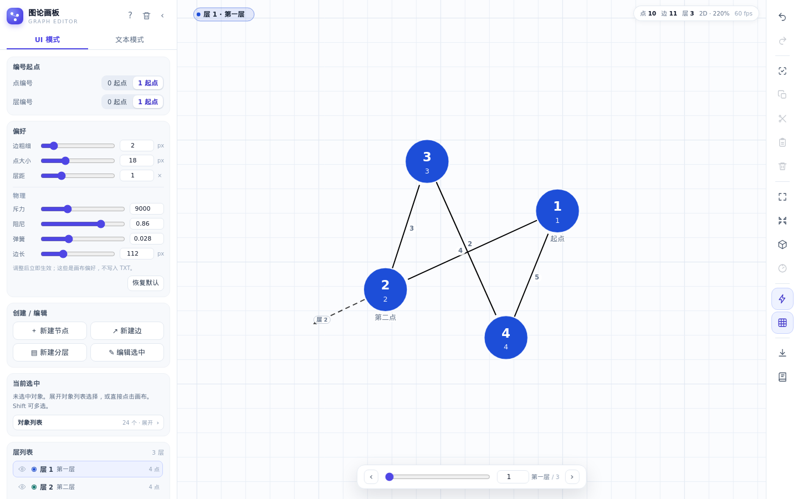
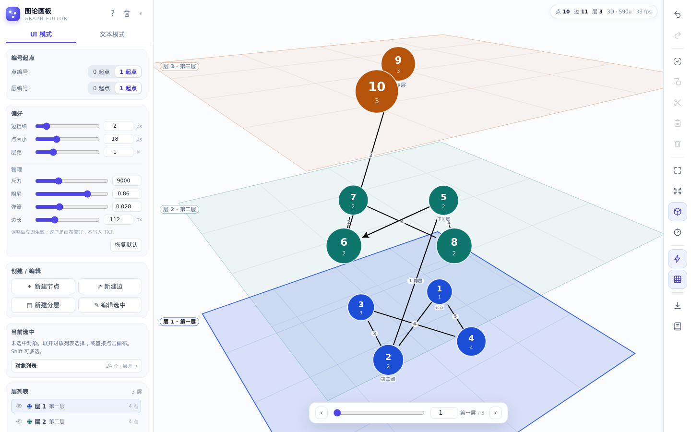
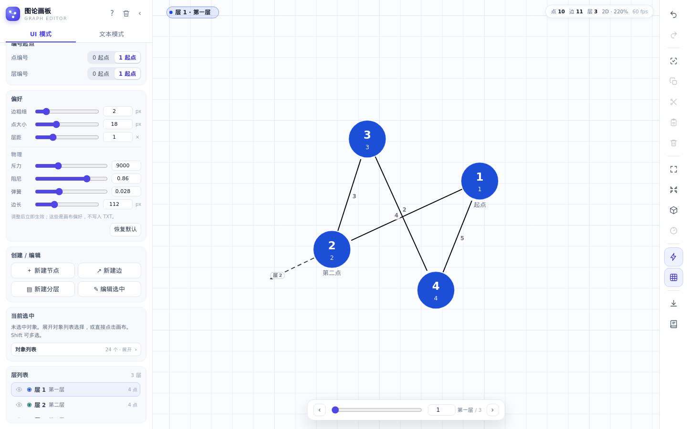
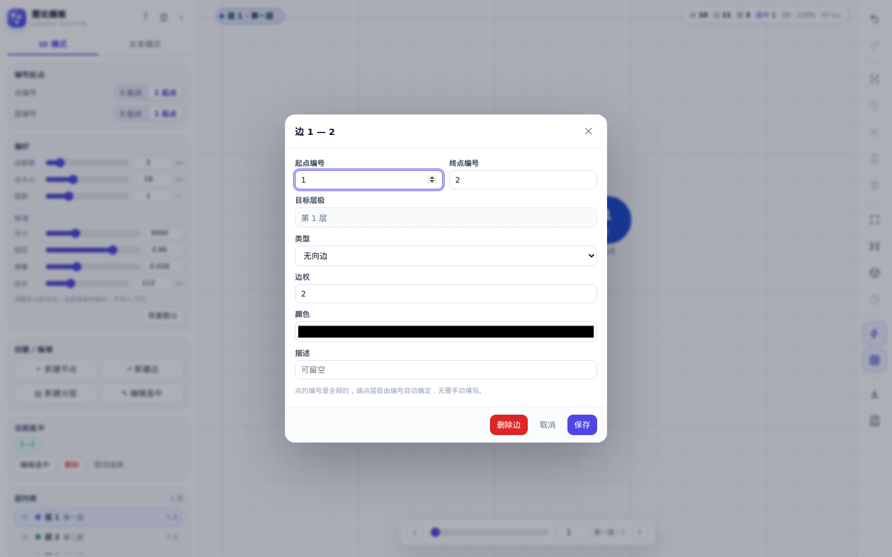
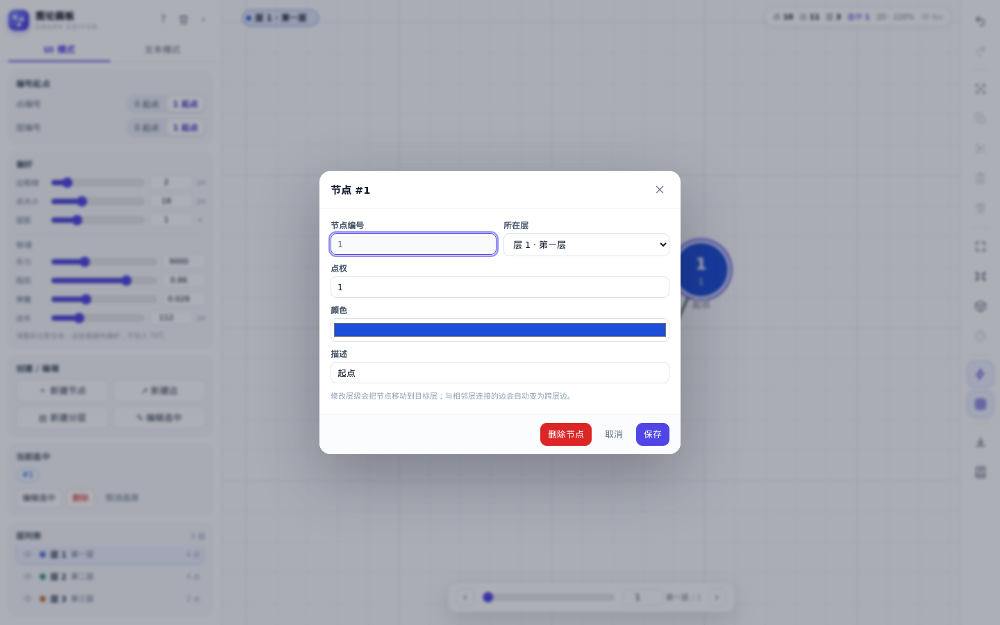

# 图论画板 · Graph Editor

一个**单 HTML、零外部依赖**的分层图论画板。原生 HTML + CSS + JavaScript 编写，用 Canvas 2D 绘制，不依赖框架、CDN、WebGL 或后端。

支持分层（2D  剖面）与 3D 多层两种显示模式、力导向拖拽、画布缩放/平移/框选、完整的撤销重做、TXT 文档双向同步，以及 PNG / JPEG 导出；层支持主题色与描述，画布/物理参数可在“偏好”中调整。











---

## 快速开始

### 直接打开

双击 **`dist/graph-editor.html`** 即可使用（单文件，全部 CSS / JS 已内联，离线可用）。

也可以直接打开开发入口 `src/index.html`（普通 `<script>` 标签，无需本地服务器）。

### 构建单 HTML

需要 Node.js 18+：

```bash
node build.mjs                 # 输出 dist/graph-editor.html
# 或指定位置
node build.mjs --out dist/my-board.html
```

构建脚本会：

1. 读取 `src/index.html`；
2. 把 `src/styles.css` 内联为 `<style>`；
3. 按文档顺序把 9 个 JS 文件内联为 `<script>`；
4. 检查是否遗留 `<script src>` / 外部 `href`，并打印产物体积。

产物约 **250 KiB**，无网络请求。

### 测试

```bash
node tests/smoke.mjs   # 解析器 / 数据模型 / 撤销重做，77 项断言
node tests/perf.mjs    # 力导向与解析性能
```

### 示例文档

- [`examples/sample-3-layers.txt`](examples/sample-3-layers.txt)：3 层示例（界面里的“载入示例”就是它）
- [`examples/sample-0-based.txt`](examples/sample-0-based.txt)：0 起点编号、跨层边、多维权值

---

## 项目结构

```
GraphEditor/
├── build.mjs                 # 单 HTML 打包脚本（Node，无第三方依赖）
├── package.json
├── README.md
├── SPEC.md                   # 需求文档副本
├── needs                     # 原始需求附件
├── src/
│   ├── index.html            # 开发入口
│   ├── styles.css            # 全部样式
│   └── js/
│       ├── util.js           # 通用工具：权值/颜色解析、HTML 转义、下载等
│       ├── model.js          # Graph、Mutator、命令式撤销栈
│       ├── parser.js         # TXT 语法解析与序列化
│       ├── layout.js         # 力导向：Barnes-Hut 四叉树 + 弹簧 + 阻尼
│       ├── render.js         # 2D / 3D Canvas 渲染、相机、适配视图
│       ├── ui.js             # 左侧编辑器、右侧工具栏、弹窗、操作指南
│       ├── app.js            # 应用状态、动作、文本同步、自动保存、导出
│       ├── interact.js       # 鼠标 / 键盘交互
│       └── main.js           # 启动
├── dist/
│   └── graph-editor.html     # 最终单文件产物
├── examples/
├── docs/                     # 截图与文档
└── tests/
```

模块通过全局命名空间 `window.GE` 协作，不使用 ES Module，因此 `file://` 直接打开也能运行，并且便于打包脚本按顺序拼接。

---

## 已实现功能清单

### 数据模型与编号

- ✅ 点、边、层三类实体，支持任意数量的层与跨层边。
- ✅ **全局唯一节点编号**；边行中的层号用于定位端点、隐式建点，并与点行交叉校验。
- ✅ 每层有主题色（默认蓝色 `#2563eb`）与描述，可随时修改；主题色影响 2D/3D 层显示与新节点默认颜色。
- ✅ 节点 / 层的 **0 起点 / 1 起点** 独立切换，切换后所有显示编号立即 ±1，并作为一条命令进入历史栈。
- ✅ 内部稳定 id 与显示编号分离：删除节点/层后显示编号自动紧凑，撤销可完整恢复。
- ✅ 删除节点自动删除相连边；删除层自动删除层内节点与相连边，且至少保留一层。
- ✅ 数量上限：点 10,000 / 边 1,000,000 / 层 10,000，创建与粘贴时校验。

### 编辑

- ✅ UI 模式：新建节点（自动编号 = 最大编号 + 1、**默认使用当前层主题色**、空权值/描述、当前层）、新建边（起点/终点编号、方向、权值、颜色、描述，默认黑色；目标层级只读显示，由全局编号自动确定）、新建分层、编辑选中。
- ✅ 删除选中（Delete / 编辑面板）带确认窗口，并提示连带删除的点/边/层数量。
- ✅ 双击节点、边、层编号打开属性面板，快速修改颜色、权值、描述、层级、方向、可见性；层属性还包含主题色与描述。
- ✅ 新建边会记住上一次选择的有向 / 无向类型；按 `Enter` 可确认 / 创建 / 保存弹窗。
- ✅ 当前没有选中对象时，“当前选中”面板提供默认折叠的“对象列表”；展开后按节点 / 边 / 层分组，点击即可选中并切换到对应层。
- ✅ 多选时可整体删除；单对象时提供完整属性编辑。
- ✅ 文本模式：按规范解析 TXT，**边输入边生成图**；语法错误显示行号与原因，并保留上一份有效图；“定位”按钮跳到出错行。
- ✅ UI 与文本双向同步：文本输入实时重建模型；UI 编辑实时重写 TXT。
- ✅ 导入 / 下载 `.txt`；“用模型重写”可强制归一化文本。
- ✅ 工具栏 / 快捷键：撤销、重做、全选、复制、剪切、粘贴、删除。
- ✅ 复制以节点为单位，同时复制“两端都在选中集合内”的边；粘贴生成新 id、整体偏移、保留层归属，目标层不存在时落到当前层。
- ✅ 历史栈上限 300 条命令，覆盖节点/边/层、编号切换、粘贴、颜色、权值、描述、层可见性、拖拽位置、文本替换、清空、载入示例。

### 画布与交互

- ✅ 力导向物理：同层四叉树斥力、全图弹簧、中心引力、速度阻尼；拖拽时相邻节点弹性跟随，松手后继续运行；物理开启时不会因收敛自动停止，可随时关闭。打开或刷新页面时会自动启动物理并先做一次预收敛，避免初始图静止。
- ✅ 物理开关（工具栏 / P 键）；关闭后仍可拖动节点。
- ✅ 滚轮以光标为中心缩放；右键拖动平移；2D 中键平移；3D 中键拖动旋转视角。
- ✅ 左键选择节点/边，Shift 多选，空白处拖动框选；点击层编号选中并切换到该层；选中圈与悬停圈按节点半径同比例缩放。
- ✅ 节点拖拽支持多选整体移动；3D 中沿视平面移动并保持层高。
- ✅ 2D 分层显示：只显示当前层剖面；跨层边用**向本层外侧（远离布局中心）的虚线短桩 + 对端层号**表示，绘制在普通边下方，且普通边优先响应点击，避免遮挡原边；虚线长度、箭头、虚线间隔和层号徽标随缩放与点大小按比例变化；线宽跟随“边粗细”偏好。
- ✅ 层级切换动画：交叉淡入 + 轻微位移（约 240 ms），不会直接闪现。
- ✅ 3D 多层显示：手工透视投影、半透明层平面、层间距随层数自动调整、当前层高亮、隐藏层保留间距。
- ✅ “回正”按钮 / 复位视角。
- ✅ “收拢”按钮：压缩布局到中心附近，适合物理参数过大导致节点飞散时使用，可撤销。
- ✅ 自动适应视图（初始、F 键、工具栏）。
- ✅ 节点：编号居中、点权在编号下方、描述在圆下方（>5 字省略）；边：权值与描述（>5 字省略）、有向箭头、自环。
- ✅ “偏好”面板：统一调整边粗细（0.5–12 px，默认 2）、点大小（8–40 px）、层距倍率（0.5–2.5×），以及物理斥力、阻尼、弹簧强度与边长；带“恢复默认”按钮，可一键还原全部画布偏好。均为画布偏好，不写入 TXT、不进入撤销历史，随自动保存恢复并在导出图片时生效。
- ✅ 层描述显示在层级编号旁边：2D 层徽标、3D 层标签与层列表均可见。
- ✅ 悬停高亮与属性气泡提示；选中环、悬停环。
- ✅ 网格显示开关；底部层级滑条 + 数字输入（单层时隐藏）。
- ✅ 顶部 HUD：点/边/层数量、选中数量、缩放/3D 距离、FPS。
- ✅ 左侧编辑器可折叠、可拖动改宽（220–620 px，宽度记忆）。
- ✅ 操作指南弹窗：画布操作、快捷键、TXT 语法、限制说明、制作人员。
- ✅ 自动保存到 `localStorage`（画布内容 + 模式 + 层 / 视角 + 显示/物理偏好 + 新建边方向），刷新后恢复。

### 导出

- ✅ PNG / JPEG。
- ✅ 范围：全部内容（自动适应）/ 当前视口。
- ✅ 倍率：1x / 2x / 3x / 4x（自动限制在 8192 px 内）。
- ✅ 是否包含网格（默认否）。
- ✅ 是否包含隐藏层（默认否，3D 生效）。
- ✅ 背景开关与背景色；PNG 可透明，JPEG 强制不透明。
- ✅ 自定义文件名。

---

## TXT 文档格式

完整语法见运行后的“操作指南”，以下为速查：

```text
#pointnumber 0|1 #floornumber 0|1     ← 可选，放在首行之前
N M [F]                                ← 点数量 边数量 [层数量]，单层可省略层数
a b [fa fb] dir [weight] [color] [desc]  ← 共 M 行；多层时 fa/fb 必须写
P [weight] [floor] [color] [desc]        ← 共 N 行，可整体省略；多层时 floor 必须写
F [0|1] [#层颜色] [desc]                 ← 共 F 行，可整体省略
```

规则：

- 编号默认 1 起点，可用 `#pointnumber` / `#floornumber` 改为 0 起点；两个指令可写在同一行，用空格分隔。
- `dir` 必须写：`0` 无向、`1` 有向。
- 层主题色在 `F` 行的可见性之后、描述之前，可写 `#RGB` / `#RRGGBB`，默认蓝色 `#2563eb`。UI 新建节点默认使用所在层主题色；新建边仍默认黑色。
- 权值可省略；多维写 `(1,2.5,3)`（括号与逗号之间不要有空格）。
- 颜色为 `#RGB` 或 `#RRGGBB`，可省略（默认黑色）。
- 描述位于行末，可包含空格与中文；超过 5 个字符时在画布上显示省略号。层描述会显示在层编号旁边。
- 边行可以先于 P/F 行引用尚未声明的点与层；多层时点行层级必须与边行中的层号一致。
- 解析错误会带行号提示，例如：`第 8 行：节点 1 的层级与边行中声明的不一致（第 0 层 vs 第 1 层）`。

---

## 快捷键

| 快捷键 | 功能 |
| --- | --- |
| `Ctrl/Cmd + Z` | 撤销 |
| `Ctrl/Cmd + Y` 或 `Ctrl/Cmd + Shift + Z` | 重做 |
| `Ctrl/Cmd + A` | 全选（2D 当前层 / 3D 可见层） |
| `Ctrl/Cmd + C` / `X` / `V` | 复制 / 剪切 / 粘贴 |
| `Delete` / `Backspace` | 删除选中（确认） |
| `F` | 适应视图 |
| `G` | 网格开关 |
| `P` | 物理开关 |
| `3` | 2D / 3D 切换 |
| `+` / `-` | 缩放 |
| `0` | 适应视图 |
| `Enter` | 在弹窗中确认 / 创建 / 保存 |
| `Esc` | 关闭弹窗 / 取消框选 |
| `?` | 操作指南 |

鼠标：滚轮缩放；右键拖动平移；中键在 3D 旋转视角；双击节点/边/层编号打开属性。

---

## 实现说明

### 编号模型

显示编号 = 实体在排序中的序号 + 起点偏移（0 或 1），内部 id 稳定且不复用。这样：

- 删除中间实体后，后续显示编号自动紧凑，TXT 始终可表示；
- 切换 0/1 起点只改偏移量，是一条可撤销的轻量命令；
- 复制/粘贴、撤销/重做不会因重新编号而混淆内部引用。

### 撤销 / 重做

采用“命令 + 差量补丁”的实现（`model.js` 中的 `Mutator` / `applyCommand`）：

- 每次操作记录新增、删除、修改前后的实体；
- 删除节点先把相连边记入补丁，撤销时按“层 → 点 → 边”的顺序恢复；
- 文本整体解析使用前后两份 Graph 的对象替换命令；
- 连续文本编辑在 900 ms 内合并为一条历史。

### 力导向

- 同层内使用 Barnes-Hut 四叉树近似斥力（≤260 个点的层用 O(n²) 精确计算）。
- 所有边（含跨层边）提供弹簧力，跨层边只影响 x/y，z 由层号固定。
- 每个模拟步使用固定时间片，速度阻尼、斥力、弹簧强度与自然边长均可在“偏好”中调整；最大速度限制，alpha 冷却。
- 边数超过 30,000 时按步轮换采样，避免每帧遍历百万条边。
- 隐藏层仍参与模拟。

### 渲染

- 纯 Canvas 2D，无 WebGL / 第三方库。
- 2D 使用世界坐标 → 屏幕坐标的相机变换；所有节点/边做视口剔除。
- 3D 使用手工透视投影与轨道相机（yaw / pitch / distance / target），层平面按深度排序绘制。
- 文本、边标签、层平面标签都有 LOD：缩得太小或数量太多时降级，保证 <100 点时的流畅度。
- 边标签在缩放较小或边数过多时隐藏，放大后自动出现。

### 构建

`build.mjs` 只做内联与断言，不引入 bundler：

- 保证产物中不残留 `<script src>`；
- 只检查 `<script>` / `<link>` / `` 等资源请求；作者板块中的 GitHub `<a>` 链接是正常导航；
- 构建后单文件可直接通过 `file://` 打开。

---

## 性能实测

测试环境：Node 24 / 无头 Chromium 131（软件渲染，无 GPU），画布约 1062 × 900。

| 场景 | 结果 |
| --- | --- |
| 100 节点 / 300 边 2D | 60 fps |
| 100 节点 / 300 边 3D | 60 fps |
| 50 节点 / 120 边 物理 | ≈0.20 ms/步 |
| 100 节点 / 300 边 物理 | ≈0.60 ms/步 |
| 1,000 节点 / 3,000 边 物理 | ≈24 ms/步 |
| 10,000 节点 / 20,000 边 物理 | ≈295 ms/步 |
| TXT 解析 5,000 点 / 20,000 边 | ≈75 ms |
| TXT 序列化同规模 | ≈41 ms（0.7 MiB） |

规模较大时会明显卡顿，符合需求中“≥100 可接受卡顿、<100 保持流畅”的约定；渲染与物理均做了降级处理。

---

## 未实现 / 已知限制 / 待确认

1. **TXT 行尾歧义（格式本身导致）**：当点权/边权为空、而描述以数字或合法颜色（`#` 开头）开头时，解析器会把描述开头当成权值/颜色。层描述以 `0`/`1` 开头时会被当成可见性标记，以颜色 token 开头时会被当成层主题色。序列化会按同一规则输出，因此这类内容无法无损往返。建议同时写出权值或调整描述。已在操作指南中注明。
2. **单层文档的层数为 0**：当前要求层数 ≥ 1，会报错；0 层文档被拒绝。
3. **2D 导出范围**：“全部内容”只包含当前层剖面（2D 本来就不显示其他层）；跨层边以短虚线桩呈现，不导出完整连线。
4. **复制/粘贴以节点为单位**：不支持单独复制层；只选中层时复制不会产生内容。剪切层会删除层及其内容（等同删除）。
5. **平行边**：允许创建多条同端点边，但渲染会重叠，未做曲线分离。
6. **触摸/手写笔**：仅针对桌面鼠标与键盘优化，未做移动端手势。
7. **权重视觉映射**：点权不改变节点半径，仅作文本显示（经确认的选择）。
8. **超大规模**：
   - 边数 > 20 万时暂停自动生成文本（可手动“用模型重写”）；
   - 3D 层数 > 260 时层平面降级为描边，层标签按步长抽样；
   - 10,000 点 / 1,000,000 边时交互和渲染会明显变慢。
9. **导出尺寸**：自动限制单边 ≤ 8192 px，必要时降低倍率。
10. **自动保存** 依赖 `localStorage`，清空浏览器数据会丢失；未提供多文件项目管理。
11. **边粗细 / 点大小 / 层距 / 物理参数是画布级偏好**：不属于图数据，不写入 TXT、不进入撤销历史；切换或重新解析文本不会改变这些偏好，导出图片与 3D 显示均使用当前值。
12. **对象列表上限**：未选中时按类型分组展示，每组最多显示前 30 个对象；更多对象可通过画布、层滑条或文本选择。
13. **层主题色只影响之后新建的 UI 节点**：不会重新着色已有节点；TXT 中省略点颜色时仍按原规范使用黑色。
14. **文本严格校验**：输入过程中容错（最后一行未完成不报错），失焦时做最终校验；若文档缺行会在失焦后提示。
15. **UI 边对话框不再输入层号**：点的编号是全局的，新建 / 编辑边时只读显示端点的实际层级；层号输入框已移除，避免与全局编号产生无意义的冲突。

---

## 验证

- `tests/smoke.mjs`：77 项断言，覆盖 0/1 起点、多层、跨层边、层颜色、省略点行、多维权值、自环、序列化往返、错误行号、编号紧凑、撤销/重做、层删除恢复等。
- `tests/perf.mjs`：布局与 TXT 解析性能。
- 另用 Playwright（无头 Chromium）做了真实浏览器回归：框选、Shift 多选、复制粘贴、双击编辑、层切换动画、隐藏层、3D 旋转、导出、100 节点 60 fps、文本错误恢复、层颜色继承、对象列表、收拢、物理偏好、回车确认等，全部通过；`docs/` 中截图来自该回归。由于浏览器测试依赖外部 Playwright / Chromium，未随项目附带（`tests/smoke.mjs` 与 `tests/perf.mjs` 为纯 Node、零依赖测试）。


---

## 制作人员

- 作者：**yihang_su**
- Github：<https://github.com/yihang13>
- 本项目 Github 地址：<https://github.com/yihang13/Graph-Editor>
- AI 使用：DeepSeek V4.1 Flash 1017 + DeepSeek Harness，提示词见文档 SPEC 和 New SPEC。截至 1.0 版本，共消耗 141312557 tokens，合 6.13 CNY。

如果您觉得本项目对您有帮助，不妨在 Github 上为我们点亮 Star，谢谢！
